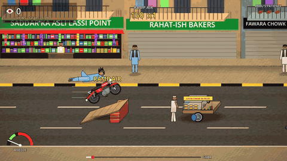

# Pindi Boy

**▶ Play free in your browser (phone or computer): https://ahab94.github.io/pindi-boy/**

**Shani is 17, lives in Pindi, and has borrowed Abbu's 70. He films everything. Every wheelie, every near-miss and every crash is content.**

A side-on stunt rider with an angled view, in the spirit of the old excite-style bike games. You get views for wheelies, air, tricks, close calls and chaos, and Abbu takes the keys after three crashes. It's built in Godot 4 and everything is drawn in code.

## Controls

| Key | Action |
|---|---|
| Right / D | Gas |
| Left / A | Brake (the rear brake also drops a wheelie) |
| Up, Down / W, S | Change lane |
| Space | Wheelie: hold it and the bike balances itself; let go before the needle by the bike reaches red |
| Shift / C | JUMP: hold to crouch, let go to hop (hold into a ramp for huge air) |
| Up / Down (in the air) | Backflip / frontflip (only while held; land level!) |
| Left / Right (in the air) | Spin a 360 |
| J K L U | Grabs: NO HANDS, SUPERMAN, SEAT STAND, SELFIE. Hold to tweak, let go before landing |
| X | PATAAKHA: the "tuned" silencer backfires |
| R / Esc / Enter | Retry / menu / next ride |

**On a phone or tablet** there are just six buttons, which appear automatically. On the left, UP, DOWN and BRAKE (in the air these become BACK FLIP, FRONT FLIP and SPIN). On the right, WHEELIE, JUMP and TRICK. Hold TRICK and slide to a trick (NO HANDS, SUPERMAN, SEAT STAND, SELFIE, PATAAKHA); a quick tap repeats your last one. The bike speeds up by itself, and II pauses. It plays upright or sideways.

## Install

- **Browser:** https://ahab94.github.io/pindi-boy/
- **macOS / Linux:** `curl -fsSL https://raw.githubusercontent.com/ahab94/pindi-boy/main/install.sh | bash`
- **Windows (PowerShell):** `irm https://raw.githubusercontent.com/ahab94/pindi-boy/main/install.ps1 | iex`
- Or grab a zip from [Releases](https://github.com/ahab94/pindi-boy/releases).

## Tricks
- **Get air:** speed breakers, plank ramps, or your own JUMP (hold, let go).
- **In the air:** flips (Up/Down), spins (Left/Right) and grabs (J K L U), all at once if there's time. Land level and with whole spins.
- **JIGRA meter:** stunts fill it. Full = **SCENE ON!**: double views, a boost, and super tricks (BHANGRA ON THE SEAT, HANDSTAND, ULTA VLOG) on the grab buttons.
- **Wheelies** link jumps into one big combo.

## How scoring works
- Stunts add views to a **combo pot** and raise the **multiplier**. Repeats are worth half as much each time and don't raise it, so variety pays.
- The combo stays alive while the front wheel is up or you're in the air. A second on two wheels **banks** it: pot × multiplier.
- A crash loses the combo. You still get +100 views, because fail videos sell.
- **Abbu's patience:** three crashes and he takes the keys.
- Holding WHEELIE balances the bike for you, but the held angle creeps up after a couple of seconds. Let go before the red on the gauge by the bike, or you loop it.
- Landing before a trick finishes is a SLOPPY landing (you lose the combo). If there isn't enough air for a trick, it's refused with TOO LOW.
- On the first rides a coach tells you what to do next, and the matching touch button glows.

## The rides
| # | Ride | What's new |
|---|---|---|
| 1 | Gali Number 4 | Riding, lanes, the wheelie, potholes (wheelie over them) |
| 2 | Speed Breaker Wali Sarak | Speed breakers launch you; NO HANDS |
| 3 | Raja Bazaar Rush | Traffic, crossers, CLOSE CALLS |
| 4 | Pataakha Silencer | X backfires: pigeons scatter, goats bolt, uncles jump |
| 5 | The Plank Ramp | Plank ramps over thelas; SUPERMAN |
| 6 | Warden Sahab | A traffic warden chases you; get caught and it's a CHALAAN |
| 7 | Sawa-Sau Day | The 125: faster, bigger air; SEAT STAND; ulta rickshaws |
| 8 | Barish in Pindi | Rain and puddles that skid you |
| 9 | Shaadi Season | Baraats; a SELFIE WITH DULHA |
| 10 | Ammi Ki Dawai | Ammi throws chappals from the awnings; the warden's back |

Targets are tuned with a deliberately sloppy "rookie" bot (`tests/sim.gd --rookie`), whose views/target ratio falls from about 1.6 to 0.8 across the ten rides. An expert bot must pass every ride (`checks/autoplay.sh`).

## Look and sound
- **The look:** an oblique view where depth slides up and to the right. Wheelies read in profile, and shops, vans and buses show front, top and side.
- **The street:** procedural asphalt, paving and plaster textures, outlined and top-lit characters, soft shadows, neem trees and a tangle of wires, plus a full-screen grade, glow and vignette (`scripts/post.gdshader`).
- **Sound:** all synthesized by `python3 tools/make_audio.py`. It makes an engine putt-putt that revs with speed, the pataakha bang, the rickshaw pom-pom, the warden's whistle, a record scratch, a sad trombone, crowd cheers and a bhangra-trap ride theme.
- **The tone:** affectionate Pindi satire. There are no real brands ("the 70", "the 125") and no politics or religion. Shani is the hero, and the joke is the stunts.

## Building it yourself
Godot 4.7. `godot --path .` runs it. `bash checks/verify.sh` runs the tests, a touch-controls test, and a bot that must pass every ride. Every `v*` tag builds Windows, macOS, Linux and Web in GitHub Actions and publishes the release and the browser version.

Credits are in [CREDITS.md](CREDITS.md).

## Roadmap
- [x] v0.1.0: 10 rides, mobile touch controls, bots and tests, synthesized Pothohari audio, 10 Shorts and a trailer
- [x] v0.2.0: the trick update (jump, flips, spins, held grabs, the JIGRA meter and SCENE ON super tricks, smoother animation)
- [x] v0.1.1: browser sound fixed, assisted wheelies, a gauge on the bike, forgiving tricks, a coach and a How to play page
- [ ] Tune the feel from players' feedback
- [ ] More people and vehicle detail in the 2D art
